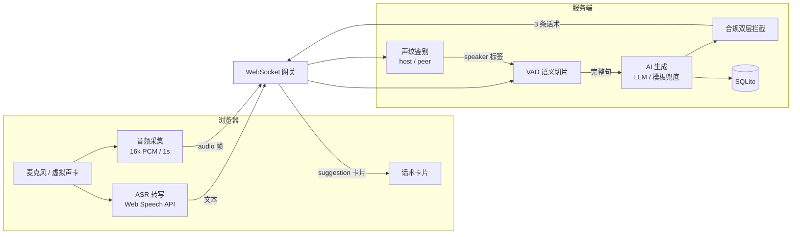

# Live Script Copilot · AI 实时话术辅助

<p align="center">
  
  
  
  
  
</p>

> **English:** Live Script Copilot is an open-source web tool that listens to a livestream viewer's speech in real time and instantly generates 3 ready-to-read response scripts for the host. Built with React + FastAPI + SQLite, it runs 100% locally, supports any OpenAI-compatible LLM, and includes a voiceprint feature to automatically distinguish the host from the other party. No paid API key required to try it (auto mock mode).

给直播主播用的 **实时话术辅助工具**：浏览器实时「听懂」对方说的话，秒级生成 **3 条可以直接照念的应对话术**。纯本地可跑、支持任意 OpenAI 兼容大模型、自带声纹校准自动区分主播/对方，未配置密钥也能零费用完整体验。

---

## ✨ 功能特性

- 🎙️ **实时听懂对方**：浏览器原生语音识别（Web Speech API）把对方的话实时转写；不支持时自动切到手动输入兜底。
- 💡 **秒级生成 3 条话术**：基于语义切片把一句话切干净，AI 生成可直接照念的应对话术，流式逐字弹出。
- 🧑🔊 **声纹校准（主播/对方分离）**：提前录 3 秒主播原声，直播时自动判定「当前声音是不是主播本人」——主播自己说话只转写不生成，只有对方说话才出话术。
- 🛡️ **合规双层拦截**：System Prompt 禁令 + 6 类红线词库（极限词/医疗功效/诱导打赏/辱骂/涉政涉赌/金融承诺），高危自动降级模板话术。
- 💸 **成本可控**：genId 单调递增去重、single-flight 节流（1200ms）、md5 去重（3000ms）、单场 LLM 调用上限熔断。
- 🗂️ **多套人设**：带货 / 连麦 PK / 应对黑粉等场景分别配置语气与禁词。
- 📜 **话术沉淀**：历史会话与话术自动入库，可复盘。
- 🔌 **任意 LLM**：DeepSeek / 通义 / 豆包 / OpenAI 等 OpenAI 兼容协议即插即用；无密钥自动进入 mock 模式。

---

## 🖥️ 效果预览

> 截图待补充：把页面截图放进 `assets/` 目录，并把下方链接替换即可。
>
> - 实时辅助页（`/` 或 `/live`）：对方说话 → 右侧浮出 3 条大字号话术卡片
> - 人设页（`/persona`）：声纹校准入口、多套人设管理
> - 历史页（`/history`）：话术沉淀与复盘

---

## 🏗️ 架构



**链路一句话**：`麦克风 → ASR 转写 → VAD 语义切片 → 声纹分离(host/peer) → AI 生成(含合规双重拦截) → 大字号话术卡片 → 一键复制`

---

## 🚀 快速开始

### 方式一：Python 后端（推荐）

```bash
# 1. 克隆
git clone https://github.com/<your-name>/live-script-copilot.git
cd live-script-copilot

# 2. 前端依赖
npm install

# 3. Python 后端虚拟环境（项目内置 venv 也可直接用）
cd apps/server-py
python3 -m venv .venv && source .venv/bin/activate
pip install -r requirements.txt
cd ../..

# 4. 配置环境变量（可先不改，默认 mock 模式）
cp .env.example .env

# 5. 启动后端（终端 A）
cd apps/server-py && python -m uvicorn app.main:app --host 127.0.0.1 --port 8787 --reload

# 6. 启动前端（终端 B）
npm run dev
```

打开 http://127.0.0.1:5173 注册即可使用。**未配置 `LLM_API_KEY` 时后端自动进入 mock 模式，可完整体验全链路，零费用。**

### 方式二：Node 后端（已归档，仅兼容性保留）

```bash
npm install
npm run dev          # 同时起 Web(5173) 与 Node 后端(8787)
```

> Node 版与 Python 版**共享同一套**环境变量、REST 路径 `/api`、WebSocket 路径 `/ws`、SQLite 库文件，可直接替换。

### 接入真实大模型

把 `.env` 改成你的 OpenAI 兼容网关即可：

```bash
LLM_BASE_URL=https://api.deepseek.com/v1
LLM_API_KEY=sk-你的密钥
LLM_MODEL=deepseek-chat
```

腾讯云 MaaS / 通义 / 豆包等均走 OpenAI 兼容协议，替换 `LLM_BASE_URL` 即可。

---

## ⚙️ 配置

所有配置项见 `.env.example`，关键项：

| 变量 | 说明 | 默认 |
|---|---|---|
| `LLM_API_KEY` | 留空 → 自动 mock 模式（零费用演示） | 空 |
| `LLM_BASE_URL` / `LLM_MODEL` | OpenAI 兼容网关与模型名 | DeepSeek |
| `CORS_ORIGIN` | 前端来源，生产按域名改 | `http://localhost:5173` |
| `DATABASE_URL` | SQLite 路径 | `./data/app.db` |
| `FEATURE_GENERATE` | 紧急关闭生成能力（降级为仅转写） | `on` |
| `MAX_LLM_CALLS_PER_SESSION` | 单场 LLM 调用上限（成本熔断） | `400` |
| `VOICEPRINT_BACKEND` | `auto` 自动探测 wespeaker，否则纯 numpy MFCC | `auto` |
| `VOICEPRINT_HOST_THRESHOLD` | 判定为「主播本人」的余弦相似度阈值 | `0.80` |
| `VOICEPRINT_CHUNK_MS` | 直播时推送 PCM 的切片时长 | `1000` |

---

## 📖 使用说明（主播视角）

1. **注册登录** → 系统自动种一个「亲和逼单」预设人设。
2. **人设管理页**（`/persona`）按场景建多套人设（带货 / 连麦 PK / 应对黑粉），决定 AI 说话口气与禁词。
3. **实时辅助页**（`/live`）点「开始收音」→ 对方说话 → 右侧浮出 3 条话术。
4. 快捷键 `⌘/Ctrl + 1/2/3` 复制对应话术，直接念出来。

### 声纹校准：自动区分主播 / 对方

直播里主播自己说话不该触发话术生成（那是给自己提词），只有「对方」说话才要生成。

- 在**人设管理页**点「声纹校准」→ 录 3 秒主播原声 → 服务端提取声纹嵌入（存 `personas.voiceprint_b64`）。
- 进入**实时辅助页**，「声纹」指示灯亮起即代表已启用。
- 之后主播自己说话 → 标 `host`（不生成）；对方说话 → 标 `peer`（生成 3 条话术）。

| 项 | 说明 |
|---|---|
| 声纹后端 | `auto`：探测到 `wespeaker`（torch + 模型，生产推荐）走它，否则纯 `numpy` MFCC 基线（零额外依赖） |
| 判定 | 余弦相似度 ≥ `VOICEPRINT_HOST_THRESHOLD`（默认 0.80）判为主播本人 |
| 时间平滑 | 每帧得分按 `0.4*历史 + 0.6*新` 平滑，抑制单帧抖动 |
| 隐私 | 仅存声纹嵌入向量，原始音频不落盘 |

> 纯 numpy MFCC 基线区分度有限（合成音 / 近似音色易误判），生产环境建议配置 `wespeaker` 后端后再按真实环境调阈值。

### macOS 采集对方声音的说明（重要）

浏览器安全模型下网页**无法直接采集系统音频**，有三条路径：

| 方案 | 做法 | 适用场景 |
|---|---|---|
| A 麦克风拾取外放声 | 直接点「开始收音」 | 最快验证，回声略降准确率 |
| B 虚拟声卡直采（推荐） | 安装 [BlackHole](https://existential.audio/blackhole/)，在「音频 MIDI 设置」建多输出设备，把浏览器输入选为 BlackHole | 连麦对方声音最干净 |
| C 手动输入兜底 | 页面底部输入框，敲回车即生成 | ASR 不可用时保证不断线 |

> Chrome / Edge 才能用浏览器原生语音识别；Safari / Firefox 会自动切到手动输入模式。

---

## 🧩 技术栈

| 层 | 选型 |
|---|---|
| 前端 | React 18 · Vite 5 · TypeScript · Zustand · 原生 CSS |
| 后端（推荐） | Python · FastAPI · uvicorn · SQLite · numpy（声纹 MFCC 基线） |
| 后端（兼容） | Node.js 20+ · Express · ws · better-sqlite3 |
| ASR | 浏览器原生 Web Speech API（含手动文本兜底；云端 ASR 适配位预留） |
| LLM | OpenAI 兼容协议（默认 DeepSeek），无密钥自动 mock |
| 合规 | 双层拦截：System Prompt 禁令 + 6 类红线词库 |

---

## 📁 目录结构

```
live-script-copilot/
├── apps/
│   ├── web/                      React 18 + Vite 5 + TypeScript（原生 CSS）
│   │   └── src/
│   │       ├── pages/            Live(实时辅助) / Persona(人设) / History(话术沉淀)
│   │       └── lib/              asr(Web Speech 封装) / ws(重连客户端) / api / protocol
│   ├── server/                   【Node 版，已归档】Express + ws + SQLite
│   └── server-py/                【Python 版，推荐】FastAPI + uvicorn + SQLite
│       ├── app/
│       │   ├── main.py           FastAPI 装配 / CORS / /ws 路由 / 可选静态托管
│       │   ├── routes.py         REST API（鉴权/人设/会话/反馈/用量/声纹）
│       │   ├── gateway.py        WebSocket 网关（会话状态机、生成编排、心跳、声纹分离）
│       │   ├── voiceprint.py     声纹说话人识别（MFCC 基线 + wespeaker 后端自动探测）
│       │   ├── llm.py            Provider 适配层（OpenAI 兼容 + mock）
│       │   ├── prompt.py         Prompt 工程 + 输出解析
│       │   ├── risk.py           合规红线守卫（双层拦截）
│       │   ├── slicer.py         语义切片（VAD 门控）
│       │   ├── singleflight.py   节流 / 去重 / 取消在途任务
│       │   ├── templates.py      模板话术兜底（降级 L1）
│       │   ├── db.py             SQLite 建表与连接（单连接 + 锁）
│       │   ├── auth.py           JWT 签发/校验 + 依赖
│       │   └── config.py         配置与 .env 加载
│       ├── requirements.txt
│       └── run.sh
├── scripts/                      自测与运维脚本（selftest / check_rules / seed / backup / 声纹集成测试）
├── docs/                         设计文档（需求/产品/技术/测试/发布/运维/运营 共 8 册）
├── .env.example                  运行配置样例
└── README.md
```

SQLite 数据表：`users` · `personas`（含声纹列）· `sessions` · `utterances` · `suggestions` · `feedback`。

---

## 🔌 API 与协议

### REST（`/api`，统一返回 `{code, message, data}`）

| 方法 | 路径 | 说明 |
|---|---|---|
| POST | `/api/auth/register` · `/api/auth/login` · `/api/auth/me` | 注册 / 登录 / 当前用户 |
| GET | `/api/personas` · POST `/api/personas` · DELETE `/api/personas/{pid}` | 人设增删查 |
| POST | `/api/personas/{pid}/voiceprint` · GET · DELETE | 声纹录入 / 状态 / 清除 |
| GET | `/api/sessions` · `/api/sessions/{sid}/detail` | 会话列表 / 详情 |
| GET | `/api/history/scripts` | 话术沉淀 |
| POST | `/api/suggestions/{sid}/feedback` | 话术反馈（复制/采用/跳过/不喜欢） |
| GET | `/api/usage/me` | 用量统计 |
| GET | `/healthz` | 健康检查（含 generate / llm 状态） |

### WebSocket（`/ws`）

客户端 → 服务端（C2S）：

| `t` | 字段 | 说明 |
|---|---|---|
| `hello` | `token`, `personaId`, `sessionId?` | 建立会话 |
| `asr_text` | `id`, `text`, `isFinal`, `speaker` | 转写文本（speaker 会被声纹覆盖） |
| `audio` | `pcmB64`, `sampleRate` | 麦克风 PCM（声纹鉴别用，1s 一帧） |
| `control` | `op`: start/stop/ping/cancel/regenerate | 控制指令 |
| `feedback` | `suggestionId`, `action` | 话术反馈 |

服务端 → 客户端（S2C）：

| `t` | 关键字段 | 说明 |
|---|---|---|
| `status` | `state`, `generateEnabled`, `voiceprintActive` | 连接状态 |
| `transcript` | `speaker`, `text`, `isFinal` | 转写（含 host/peer 标签） |
| `voiceprint` | `isHost`, `score`, `backend`, `threshold` | 声纹判定结果 |
| `suggestion` | `phase`: start/delta/done/abort, `text`, `source` | 话术流式生成 |
| `usage` | `promptTokens`, `completionTokens`, `costMicros` | 本次用量 |
| `error` / `pong` | `code`, `message`, `retryable` | 错误 / 心跳回应 |

---

## ✅ 测试与校验

```bash
# 前后端类型检查
npm run typecheck

# 合规红线校验（Python 版，10 项）
python scripts/check_rules.py

# 端到端自测（需先起后端 + 前端，或直连后端）
WEB_ORIGIN=http://127.0.0.1:5173 node scripts/selftest-web.mjs
WEB_ORIGIN=http://127.0.0.1:8787 WS_ORIGIN=ws://127.0.0.1:8787/ws node scripts/selftest-web.mjs

# 声纹端到端集成测试（注册→录入→WS 动态判定主播/对方→生成门控，11 项）
python scripts/test_voiceprint_ws.py
```

当前状态（Python 后端）：**启动 OK · check_rules 10/10 · selftest-web 12/12（直连+代理双路径通过）· 声纹集成测试 11/11**。

---

## 🚢 部署

单机部署（前端构建后由后端一并托管）：

```bash
# 1. 构建前端
npm run build -w @lsc/web        # 产物在 apps/web/dist

# 2. 启动后端（自动托管 dist 静态资源，无需单独前端服务器）
cd apps/server-py
uvicorn app.main:app --host 0.0.0.0 --port 8787
```

开发模式下前端 Vite 代理把 `/api`、`/ws`、`/healthz` 转发到 `8787`。生产环境建议在前端套一层 Nginx 并配置 HTTPS 与 `CORS_ORIGIN`。

---

## 🗺️ 路线图（Roadmap）

- [ ] 云端 ASR（讯飞 / 阿里）Provider 实现，替换浏览器原生识别
- [ ] 支付与订阅
- [ ] 战绩复盘 / 转化归因
- [ ] 多席位团队版
- [ ] 桌面端（系统音频直采，Tauri / Electron）
- [ ] CI 流水线（GitHub Actions：typecheck + 测试 + 构建）

详见 [`docs/`](./docs) 设计文档与 [`docs/07-运营增长方案.md`](./docs/07-运营增长方案.md)。

---

## 🤝 贡献

欢迎 Issue / PR！

1. Fork 并创建特性分支 (`git checkout -b feat/xxx`)
2. 提交前确保 `npm run typecheck` 与 `python scripts/test_voiceprint_ws.py` 通过
3. 发起 Pull Request

设计取舍与产品/技术背景可先阅读 [`docs/`](./docs) 下的 8 册交付文档。

---

## ⚠️ 合规声明 / Disclaimer

- 本工具定位为**辅助真人主播的提词器**；用户协议明确禁止无人直播、录播挂机。
- 音频**不落盘**，仅保留转写文本；密钥/手机号不写入日志。
- AI 生成内容仅供参考，**直播内容合规责任由主播本人承担**。
- 生产环境请勿依赖浏览器原生 Web Speech API（依赖境外服务，存在数据出境合规风险），应切换国内云 ASR。
- 声纹基线（numpy MFCC）区分度有限，生产请使用 `wespeaker` 后端并按真实环境校准阈值。

---

## 📄 许可证

本项目基于 [MIT License](./LICENSE) 开源。

---

## 🙏 致谢

- 实时转写基于浏览器原生 Web Speech API
- LLM 默认接入 DeepSeek（OpenAI 兼容协议）
- 声纹后端可接入 [wespeaker](https://github.com/wenet-e2e/wespeaker)
